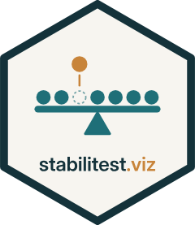

# stabilitest.viz <a href="https://github.com/ma-brain/stabilitest.viz"></a>

Interactive companion app for [stabilitest](https://github.com/ma-brain/stabilitest):
how easily could a statistical conclusion be overturned?

The app never re-implements statistics. Every number comes from stabilitest's
exported functions, and a categorical label (for example Fragile) is shown only
when stabilitest returns one. Otherwise the app says the result is numeric only.

> Status: **v0.1.0, M3 to M5 in development.** Load data, choose one of six methods, map columns, run in the
> background, read the score and explore it (removal path, influence,
> bootstrap, removed observations, interpretation, code), compare analyses and
> export a report, with a plain-language Guided mode. The release (Docker image,
> v1.0) comes next; see [NEWS.md](NEWS.md) and
> [docs/PLAN.md](docs/PLAN.md).

## Installation

```r
# install.packages("pak")
pak::pak("ma-brain/stabilitest.viz")
```

## Usage

```r
library(stabilitest.viz)

run_app()                    # local use
run_app(profile = "public")  # public companion: Guided mode, no uploads
```

Profiles and limits are defined in `inst/golem-config.yml`.

## Development

```r
Rscript dev/run_dev.R          # reload and run
devtools::document(); devtools::test(); devtools::check()
```

See [CLAUDE.md](CLAUDE.md) for project rules and [docs/](docs/) for the plan and brand.

## Licence

MIT, Marius Ardelean.
